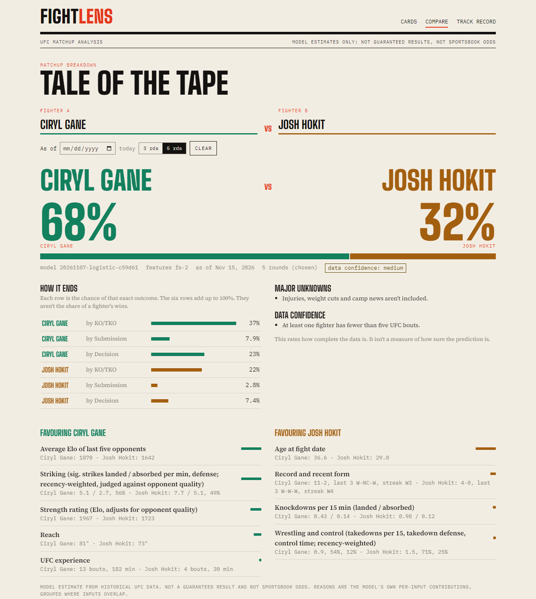
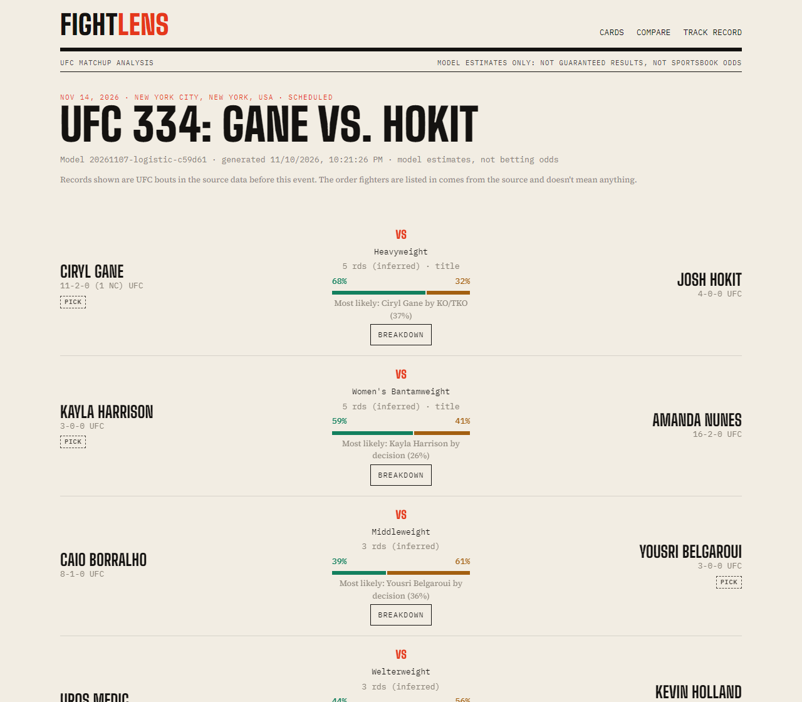
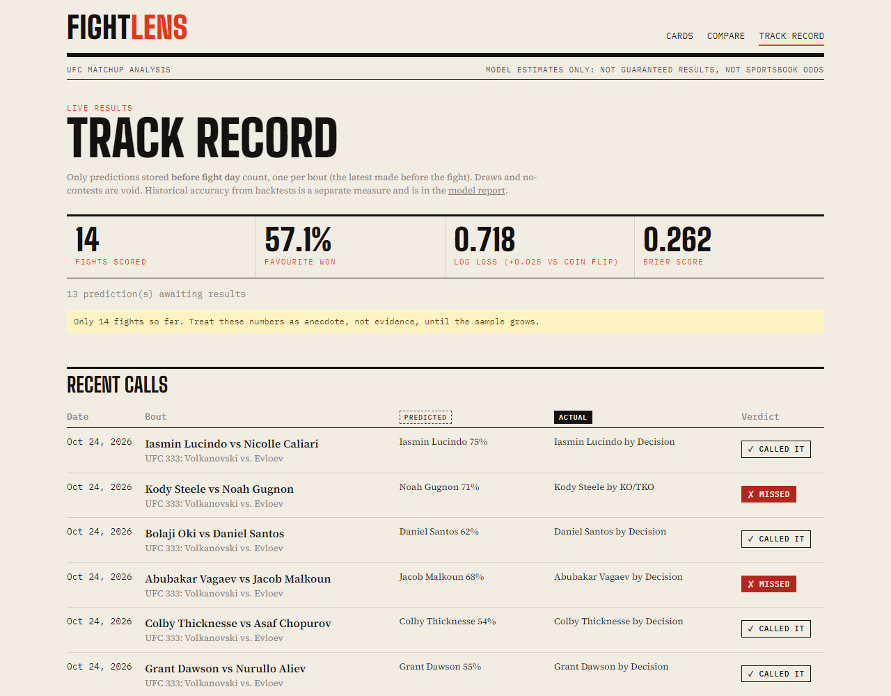
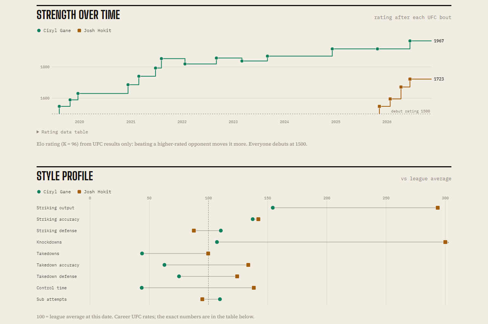
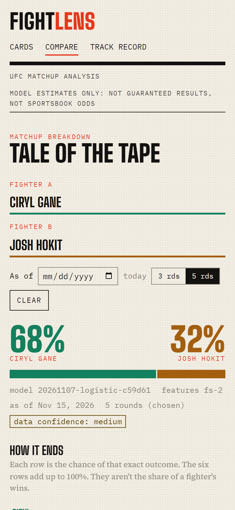
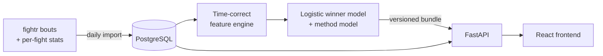

# FightLens

**UFC matchup analysis with calibrated win and method probabilities.**

**Live site:** [fight-lens-six.vercel.app](https://fight-lens-six.vercel.app)

FightLens predicts upcoming UFC fight cards and any matchup you pick: who is more likely to win, how the fight is likely to end, and which factors drive the estimate. Every prediction is built only from fights that happened before the fight date, and every prediction made before fight day is scored once the result is in.



> Outputs are model estimates, not guaranteed results and not betting odds.

---

## Features

- **Fight cards:** every upcoming bout with win probability, most likely outcome and the model's pick.
- **Any matchup:** choose two fighters, an "as of" date and 3 or 5 rounds to get:
  - the win probability and the chance of each of six outcomes (each fighter winning by KO/TKO, submission or decision)
  - the factors favouring each side, taken from the model's own weights
  - a tale of the tape, last five fights, head-to-head meetings and common opponents
- **Charts:** rating history over each fighter's UFC career, and a style profile against league averages.
- **Track record:** pre-fight predictions compared with actual results, with calibration and per-model accuracy.
- **Works on mobile.**

| Fight card | Track record |
|---|---|
|  |  |



<p align="center"></p>

---

## How it works



1. **Data.** Completed and scheduled bouts come from the [fightr](https://github.com/benyamindsmith/fightr) dataset. Per-fight striking and grappling stats come from [Greco1899/scrape_ufc_stats](https://github.com/Greco1899/scrape_ufc_stats). Imports can be re-run safely, and a result that's already recorded is never overwritten: any change is reported instead.
2. **Time-correct features.** A history engine replays every bout in date order. A fight's features use only bouts strictly before its date, so nothing from the future leaks in. The features include an Elo rating (K = 96), recency-weighted form, opponent-adjusted striking and grappling rates, physical attributes, experience and layoff.
3. **No order leakage.** The source lists the winner first more often than not, so fighter order is never used as a signal. Every feature is a difference between fighter A and fighter B, which guarantees P(A wins) + P(B wins) = 1 whichever fighter is listed first.
4. **Models.** A calibrated logistic regression predicts the winner. A separate multinomial model predicts the method (KO/TKO, submission or decision) given the winner. Multiplying the two gives the six outcomes. The explanations come from the model's own coefficients, grouped where features overlap.
5. **Versioned models.** Each trained model is saved as a bundle with a feature-schema hash. The API refuses to load a bundle whose features don't match the code.
6. **Live track record.** Predictions are stored before fight day and scored once results arrive. Only predictions made before the fight count.

### Model performance

Rolling backtest over 2016–2026 (5,369 bouts). For each test year, the model trains on earlier years, calibrates on the previous year and is scored on that year. There are no random splits.

| Model | Log loss | Brier | Accuracy |
|---|---:|---:|---:|
| **Logistic (selected)** | **0.645** | **0.227** | **62.5%** |
| CatBoost | 0.650 | 0.229 | 61.1% |
| Logistic without per-fight stats | 0.658 | 0.233 | 60.3% |
| Elo only | 0.682 | 0.244 | 55.7% |
| Coin flip | 0.693 | 0.250 | 50.0% |

Bookmaker odds are used only as a benchmark. They never feed the model, and a test enforces that. On the 4,591 backtest bouts that have odds, the market scores 0.607 log loss and 66.5% accuracy, against the model's 0.643 and 62.8%. The market is sharper because it prices in injuries, weight cuts and camp news, which the model doesn't have. Full details are in the [evaluation report](docs/model-report.md).

---

## Tech stack

| Layer | Stack |
|---|---|
| Frontend | React 18, TypeScript, Vite, React Router, hand-built SVG charts |
| Backend | Python 3.12, FastAPI, SQLAlchemy 2, Alembic, Pydantic |
| ML | pandas, scikit-learn, CatBoost (challenger model) |
| Data | PostgreSQL |
| Tooling | uv, ruff, pytest, GitHub Actions |
| Hosting | Vercel (frontend), Railway (API + Postgres) |

## Architecture

```
Browser ──► Vercel (static React app)
              └─ /api/* rewrite ──► Railway: FastAPI (Docker) ──► Railway: PostgreSQL
                                                                    ▲
GitHub Actions (daily) ── fightlens refresh ────────────────────────┘
```

- **Frontend:** Vercel serves the static build. `frontend/vercel.json` proxies `/api/*` to the API on the same origin, so the browser doesn't need CORS, and sends every other path to `index.html` so links to any page work.
- **API:** `backend/Dockerfile` (configured in `railway.toml`) runs migrations on startup and serves FastAPI. The active model bundle is committed under `data/artifacts/` and built into the image.
- **Daily refresh:** [`refresh.yml`](.github/workflows/refresh.yml) runs `fightlens refresh` against production. It fetches new data, imports results, scores finished fights and predicts newly scheduled ones. It never retrains.

---

## Running locally

Prerequisites: Docker, [uv](https://docs.astral.sh/uv/), Node 20+.

```bash
docker compose up -d db                       # Postgres on localhost:5433

cd backend
cp .env.example .env
uv sync
uv run alembic upgrade head
uv run fightlens fetch                        # download a data snapshot
uv run fightlens import
uv run fightlens import-stats
uv run fightlens train --activate             # backtest + fit (~1 min)
uv run fightlens predict
uv run uvicorn app.main:app --reload          # http://localhost:8000/docs

cd ../frontend
npm install
npm run dev                                   # http://localhost:5173
```

Tests run on in-memory SQLite and don't need a database:

```bash
cd backend && uv run pytest && uv run ruff check .
```

<details>
<summary><strong>CLI reference</strong></summary>

| Command | What it does |
|---|---|
| `fightlens fetch` | Download a new fightr snapshot to `data/raw/` |
| `fightlens import` | Import the latest snapshot (idempotent) |
| `fightlens import-stats` | Import per-fight striking/grappling stats |
| `fightlens import-odds` | Import bookmaker odds (benchmark only) |
| `fightlens train [--activate]` | Backtest, fit and save a versioned model bundle |
| `fightlens activate <version>` | Switch the active model |
| `fightlens predict` | Store predictions for scheduled bouts |
| `fightlens score` | Score stored predictions against results |
| `fightlens refresh` | fetch → import → score → predict (no retraining) |

</details>

<details>
<summary><strong>API reference</strong></summary>

Interactive docs are served at `/docs` when the API is running.

| Route | Purpose |
|---|---|
| `GET /api/events/upcoming`, `/api/events/recent` | Event lists |
| `GET /api/events/{id}` | Card with records and predictions as of the event |
| `GET /api/fighters/search?q=` | Fighter search |
| `GET /api/fighters/{id}?asOf=` | Fighter summary and full history |
| `GET /api/matchups?fighterA=&fighterB=&asOf=` | Tale of the tape, last five, head to head, common opponents |
| `POST /api/predictions/matchup` | Prediction for any pairing |
| `GET /api/predictions/{boutId}` | Stored prediction for a bout |
| `GET /api/track-record` | Pre-fight predictions against results |

</details>

<details>
<summary><strong>Deploying</strong></summary>

- **Railway API service:** leave Root Directory empty and use the Dockerfile builder (`railway.toml` points to `backend/Dockerfile`). Set:
  ```
  FIGHTLENS_DATABASE_URL=postgresql+psycopg://${{Postgres.PGUSER}}:${{Postgres.PGPASSWORD}}@${{Postgres.PGHOST}}:${{Postgres.PGPORT}}/${{Postgres.PGDATABASE}}
  PORT=8000
  ```
  Use the `postgresql+psycopg://` scheme, because Railway's own `DATABASE_URL` needs psycopg2.
- **Vercel:** Root Directory `frontend`. No environment variables are needed.
- **Model bundles** are git-ignored by default. Commit the bundle that's active in production with `git add -f data/artifacts/<version>`, then redeploy whenever you activate a different one.
- **Daily refresh:** add a repository secret `FIGHTLENS_DATABASE_URL`, set to Railway's `DATABASE_PUBLIC_URL` with the scheme changed to `postgresql+psycopg://`.

</details>

---

## Project structure

```
backend/
  app/api/          FastAPI routes
  app/ingestion/    fightr + per-fight stats importers
  app/ml/           feature engine, training, artifacts, prediction
  app/services/     predictions, history, track record
  app/db/           SQLAlchemy models + Alembic migrations
  tests/
frontend/src/       React pages, components and SVG charts
data/artifacts/     committed production model bundle
docs/               ADRs, data audit, model report
```

## Design decisions

The reasoning behind the main choices is recorded in [architecture decision records](docs/adr/):
[backend stack](docs/adr/0001-python-fastapi-backend.md) ·
[data source](docs/adr/0002-bootstrap-data-source.md) ·
[model design](docs/adr/0003-baseline-model-design.md) ·
[live track record](docs/adr/0004-live-track-record.md) ·
[data audit](docs/data-audit.md)
